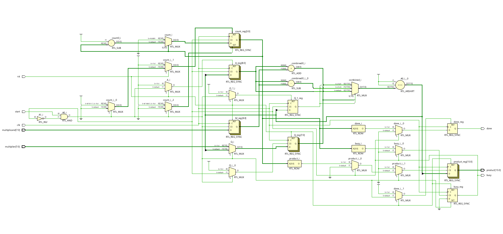
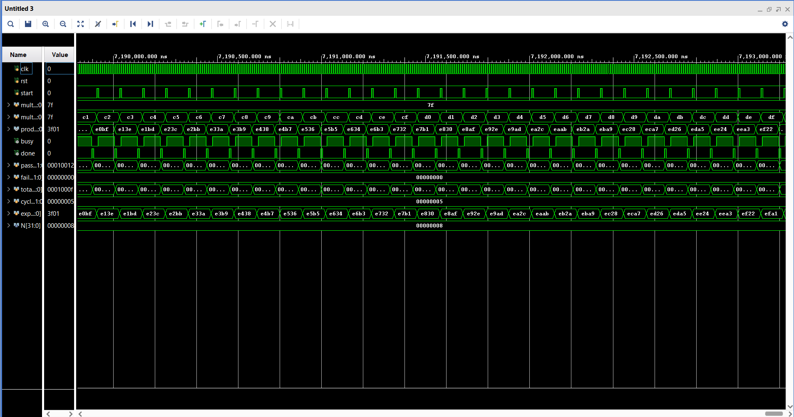

# 8-bit Signed Booth Multiplier in Verilog

A parameterized sequential signed Booth multiplier implemented in Verilog, with a self-checking testbench and Vivado RTL schematic.

## Features

- Parameterized operand width (default `N = 8`)
- Signed two's-complement multiplication
- `2N`-bit product output
- Start, busy, and one-cycle done handshake
- Synchronous active-high reset
- Self-checking testbench

## Interface

| Signal | Direction | Width | Description |
|---|---|---:|---|
| `clk` | Input | 1 | Rising-edge clock |
| `rst` | Input | 1 | Synchronous active-high reset |
| `start` | Input | 1 | Starts an operation when `busy = 0` |
| `multiplicand` | Input | N | Signed multiplicand |
| `multiplier` | Input | N | Signed multiplier |
| `product` | Output | 2N | Signed product |
| `busy` | Output | 1 | High while multiplication is in progress |
| `done` | Output | 1 | One-clock completion pulse |

## How Booth multiplication works

Each iteration examines `{Q[0], Q_1}`:

| Bits | Operation |
|---|---|
| `01` | Add the multiplicand to accumulator `A` |
| `10` | Subtract the multiplicand from accumulator `A` |
| `00` or `11` | Leave accumulator `A` unchanged |

After the selected operation, the combined accumulator and multiplier registers are arithmetically right-shifted. The design performs `N` iterations for an `N`-bit multiplication.

## Vivado RTL schematic

The image below is the actual RTL schematic screenshot from Vivado, showing the registers, multiplexers, add/subtract logic, arithmetic shift, and control connections.

## Result

Example: `3 × 2 = 6`, expected product `16'h0006`.

*Note: this result graphic is illustrative, not a direct screenshot from Vivado Simulator.*

## Verification

Run the self-checking testbench in Vivado Simulator (XSim). The testbench checks the DUT output against expected signed multiplication results.

## Project files

- `booth_multiplier.v` — Booth multiplier RTL
- `booth_multiplier_tb.v` — self-checking testbench
- `images/rtl-schematic.png` — actual Vivado RTL schematic screenshot
- `images/results.png` — result illustration for `3 × 2 = 6`

## Run in Vivado

1. Add `booth_multiplier.v` as a design source.
2. Add `booth_multiplier_tb.v` as a simulation source.
3. Set `booth_multiplier_tb` as the simulation top.
4. Run Behavioral Simulation and inspect the testbench output and waveform.

## License

No license is currently specified.

